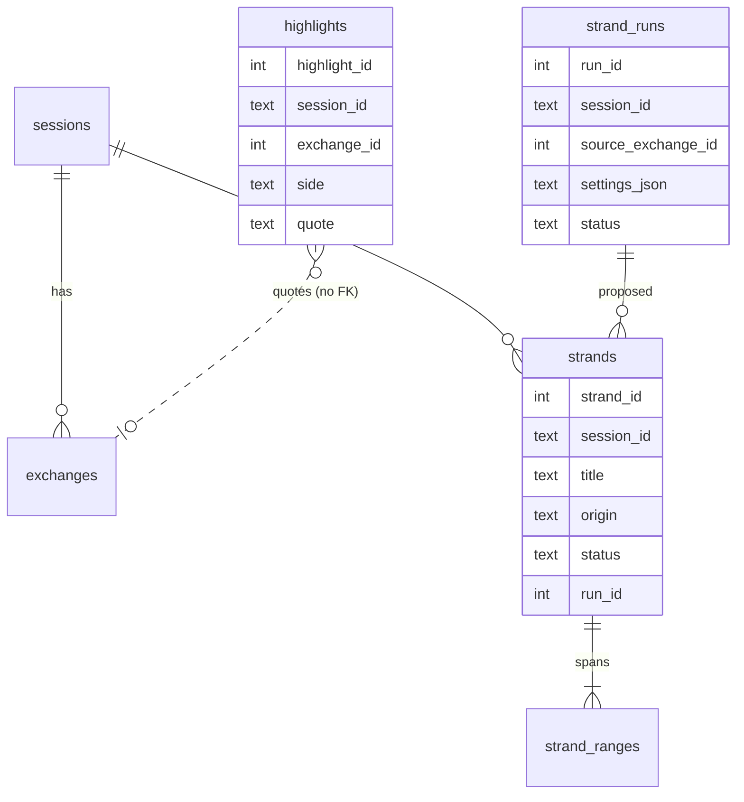
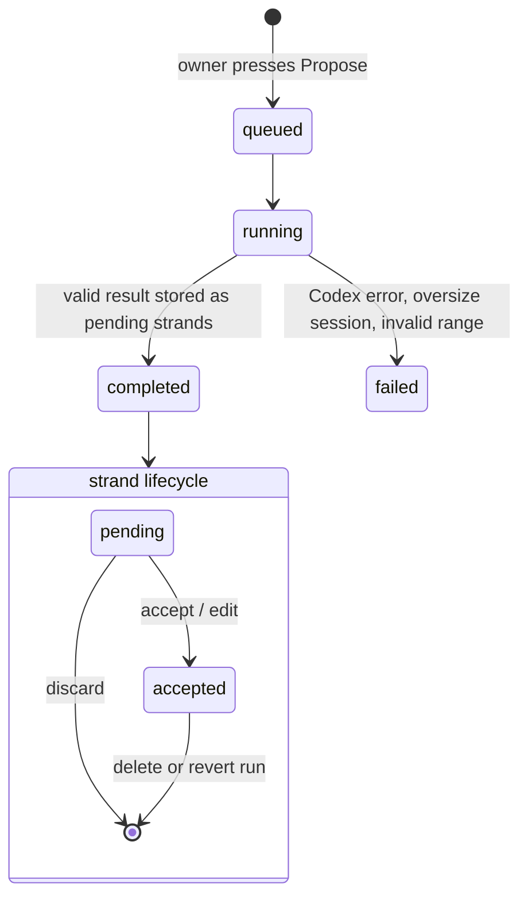

# Highlights and Strands - Plan

## Goal Capsule

- **Objective:** Inside the session view, let the owner mark resonant fragments of Bridge sessions (highlights) and cut sessions into named exchange ranges (strands), either by hand or by a manually triggered Codex run, with every mark deletable and every Codex batch revertible.
- **Authority:** This plan's Product Contract, then its Key Technical Decisions, then existing repo conventions (additive schema, admin CSRF guard, Contexts snapshot philosophy).
- **Stop conditions:** Stop and ask if the work would change `SCHEMA_VERSION`, expose highlights or strands to models over MCP, alter session groups or files, or add any automatic (unattended) Codex run.
- **Execution profile:** Backend units are test-first against `tests/`; UI units are verified in the demo admin (`scripts/demo_ui.py`).
- **Tail ownership:** Commits land directly on the current `release/*-beta` branch; no feature branch.

---

## Product Contract

### Summary

Bridge gains two independent, admin-only indexing layers over the raw transcript.
A **highlight** is a verbatim quote from one side of one exchange.
A **strand** is a named set of exchange ranges inside one session that covers one subject, created by hand or proposed by Codex from the whole session.
Neither layer rewrites or summarizes the transcript; the transcript stays the source.

### Problem Frame

The owner talks with models every day and cannot keep the result ordered.
A short but important aside (Y) inside a session about something else (X) is invisible once the session is filed under X.
Synthetic summaries are distrusted because they bend the picture and stack on each other.
The owner wants to collect anchors now, safely and reversibly, without closing off later analysis, and later automate assigning strands to cross-session topics.

### Requirements

**Highlights**
- R1. The owner can select text inside one turn (user message or model response) of one exchange; a floating Highlight button appears next to the selection and one click saves it.
- R2. The server accepts a highlight only when the quote is found in that turn's stored text after tolerant normalization.
- R3. A highlight keeps its own copy of the quote and survives later edits, exclusion, or deletion of its source, showing the source's current state.
- R4. Saved highlights are visibly marked in the session view, and the owner can delete a highlight.
- R5. Highlights carry no link to strands.

**Strands**
- R6. The owner can create a strand by hand in a session: a title plus one or more inclusive exchange ranges.
- R7. The owner can trigger, per session, a Codex run that reads the whole session transcript (no session title) and proposes strands.
- R8. Proposed strands stay pending until the owner accepts, edits, or discards them, one by one or all at once.
- R9. All strands produced by one Codex run can be reverted in a single confirmed action; manual strands are never touched by a revert.
- R10. A Codex run on a session in a sensitive group needs explicit per-run confirmation; otherwise it is refused.
- R11. Two dock buttons in the transcript side rail, Highlights and Strands, sit above the turn navigation and each open an overlay panel above the conversation; choosing an item in a panel scrolls the conversation to its exchange or range.

**Safety**
- R13. Every highlight, strand, and run can be deleted; deletes ask for confirmation.
- R14. Strand storage is shaped so a later topic layer can attach to strands and reuse the propose/accept/revert-by-run machinery.

### Acceptance Examples

- AE1. **Covers R2.** Given a model response containing `**bliskość człowieka**`, when the owner selects the rendered words "bliskość człowieka", the highlight is accepted.
- AE2. **Covers R2.** Given a selection spanning a user turn and a model turn, the UI refuses to save and explains that a highlight lives inside one turn.
- AE3. **Covers R3.** Given a saved highlight whose exchange is later edited so the quote disappears, the highlight remains and shows "source changed".
- AE4. **Covers R9.** Given a run that produced 5 strands, 3 accepted and 2 pending, plus 1 manual strand, reverting the run removes all 5 and keeps the manual strand.
- AE5. **Covers R10.** Given a session in a sensitive group, pressing "Propose strands" shows a warning and runs only after the owner confirms.

### Scope Boundaries

- Out of scope: highlight notes, a cross-session Anchors page, a session map, summaries, topics, automatic or scheduled runs, an MCP tool for highlights, external (non-Bridge) highlights, Context Builder integration, changes to session groups or files.
- Strands and highlights are never sent to models in this plan.

### Deferred to Follow-Up Work

- Cross-session Anchors page listing all highlights and strands, honoring the sensitive-group guard.
- Optional "why it resonates" note on a highlight.
- Topic layer: `topics` plus `strand_topics` with Codex-proposed assignment, reusing the run/proposal/revert pattern (R14).
- External highlights without a session (nullable source, "external" badge, later auto-anchoring through search).
- `save_highlight` MCP tool with server-side quote verification.
- Windowed strand extraction for sessions above the input limit.

---

## Planning Contract

### Key Technical Decisions

- KTD1. **Name the layer "strand", not "thread".** `thread` already names a transcript layout in `web/admin-viewer.html` and Codex threads in `app/codex_app_server.py`; reusing it would collide in code and UI.
- KTD2. **Additive tables, `SCHEMA_VERSION` stays 2.** Mirror `file_labels` and `contexts` in `app/storage.py`: new `CREATE TABLE IF NOT EXISTS` blocks that older Bridges ignore, so rollback still opens the database.
- KTD3. **Highlights hold no foreign key to sessions or exchanges.** Like `context_blocks`, a highlight stores `session_id`, `exchange_id`, `side`, and its own quote copy; its source status (`ok`, `source_changed`, `source_excluded`, `source_masked`, `source_deleted`) is computed on read. This is what makes R3 possible.
- KTD4. **Tolerant quote verification on the server.** The browser sends `Selection.toString()` from rendered markdown. The server normalizes both quote and stored turn text (strip markdown markup characters and link targets, collapse whitespace, normalize Unicode) and requires a substring match. Exact normalization rules are tuned during implementation against AE1.
- KTD5. **Strands have many ranges.** A subject the owner circles back to is non-contiguous, so `strand_ranges(strand_id, start_exchange_id, end_exchange_id)` holds inclusive ranges ordered by exchange position in the session.
- KTD6. **A strand has a title only, no summary.** Codex returns a title (≤120 chars) and ranges; no description text, so the strand stays an index, not a synthetic summary.
- KTD7. **Runs mirror Graph Lab runs, not Graph jobs.** `strand_runs` follows `graph_lab_runs` and `GraphRuntime.start_lab_run` in `app/graph_runtime.py`: a row per manual run, an in-process background task, a snapshot of model, effort, and prompt, and status `queued → running → completed | failed`. No queue, no leases.
- KTD8. **The prompt carries exchange IDs and refuses to truncate.** Unlike `GraphRuntime._build_prompt`, which drops older exchanges past `MAX_GRAPH_SOURCE_CHARS`, strand extraction labels every exchange with its ID and fails with a clear error when the whole session exceeds the limit. Silent truncation would hide exactly the asides the owner wants.
- KTD9. **Strict result validation.** Every proposed range must reference exchanges of that session up to the run's `source_exchange_id`, with start not after end. Any invalid range fails the whole run; nothing partial is stored.
- KTD10. **One pending batch per session.** A new run on a session is refused while that session still has pending proposals; the owner accepts or discards them first.
- KTD11. **Revert is by run.** Every Codex strand records `run_id`; revert deletes all strands with that `run_id`. Manual strands have `run_id` null and `origin = manual`. Topics later reuse this shape.
- KTD12. **Strand settings live in `app_settings`, Codex only.** One settings object (model, effort, prompt) with a shipped default prompt, edited in a new Settings section. Each run snapshots it, so no versioned profile table is needed.
- KTD13. **Independent of the Graph switch.** Strand runs need a logged-in Codex (`codex.status()`), not Graph enabled.
- KTD14. **Highlights use highlighter yellow (`#fde047`), not amber.** Amber already means Exclude, the sensitive-group badge, and the active All-groups filter in the admin; strands reuse the admin indigo (`#7a7df0`). Panels reuse the `.file-dock-tip` surface (`#161a24`, 12px radius, pop shadow).
- KTD15. **Codex account endpoints leave the Graph gate.** Settings › Codex shows status, sign-in and sign-out even when `BRIDGE_GRAPH_EXPERIMENTAL` is off; the Graph test chat and all Graph routes stay gated. The transcript rail is pinned to the top-left so the two docks never scroll out of view.

### High-Level Technical Design

### Sequencing

U1 → U2 → U3 deliver highlights end to end and can ship alone.
U4 → U5 → U6 deliver strands; U8 closes. The Anchors page (former U7) moved to follow-up work.

### Assumptions

- The full SQLite database export already includes new tables; U8 confirms it.
- `MAX_STRUCTURED_INPUT_CHARS` in `app/codex_app_server.py` bounds the strand prompt; most sessions fit.

---

## Implementation Units

### U1. Highlight storage and quote verification

- **Goal:** Persist highlights and verify quotes against stored turn text.
- **Requirements:** R2, R3, R5, R13
- **Dependencies:** none
- **Files:** `app/storage.py`, `app/highlights.py` (new), `tests/test_highlights.py` (new)
- **Approach:** Add a `highlights` table (KTD2, KTD3) with `quote_hash` and `created_at`. `app/highlights.py` holds normalization and the source-status computation. Store methods: create, list by session, delete. Create verifies against the current, non-deleted exchange side text; masked model text is rejected.
- **Patterns to follow:** `context_blocks` snapshot comments and `file_labels` admin-only note in `app/storage.py`.
- **Test scenarios:**
  - Covers AE1. Quote from rendered bold text matches stored markdown.
  - Quote with collapsed or extra whitespace and line breaks matches.
  - Quote absent from the turn is rejected; quote present only on the other side is rejected.
  - Highlight on a deleted exchange or masked model response is rejected at creation.
  - Covers AE3. After the exchange is edited to remove the quote, listing shows `source_changed` and keeps the quote.
  - Excluded exchange shows `source_excluded`; deleted session shows `source_deleted`.
  - Empty or whitespace-only quote, and quote over the length cap, are rejected.
  - Delete works; delete of an unknown id reports not found.
- **Verification:** Store tests pass; an older-schema database opened by `Store` gains the table without a version change.

### U2. Highlight admin API

- **Goal:** Expose highlight CRUD to the admin UI.
- **Requirements:** R1, R4, R13
- **Dependencies:** U1
- **Files:** `app/admin_anchors.py` (new), `app/main.py`, `tests/test_highlights_api.py` (new)
- **Approach:** A handler class like `ContextAdminHandlers` that reuses `AdminHandlers` login, CSRF (`_require_admin_mutation`), and JSON error helpers. Routes under `/admin/api/sessions/{session_id}/highlights` (GET, POST) and `/admin/api/highlights/{highlight_id}` (DELETE).
- **Patterns to follow:** `app/admin_contexts.py`, route registration in `app/main.py`.
- **Test scenarios:**
  - POST without session cookie returns 401; without CSRF header returns 403.
  - POST with a verifiable quote returns the highlight; with an unverifiable quote returns 422 and a clear message.
  - GET for a session returns highlights with source status; unknown session returns 404.
  - DELETE removes the highlight; DELETE twice returns 404.
- **Verification:** API tests pass.

### U3. Highlighting in the session view

- **Goal:** Select, save, show, and remove highlights while reading a session.
- **Requirements:** R1, R4, R11, AE2
- **Dependencies:** U2
- **Files:** `web/admin-viewer.html`, `tests/viewer_harness.py` and a viewer test if the harness covers DOM behavior
- **Approach:** On `mouseup` inside a `.turn-content`, show a floating Highlight button beside the selection; one click posts the quote, `exchange_id`, and side. Selections crossing turns show a short hint instead (AE2). After rendering exchanges, wrap matching text of each saved highlight in `<mark>`. A Highlights dock button in `.side-rail`, above `#turnNav` and styled like the existing `.file-dock` (icon, color stripe, count), opens an overlay panel beside the rail listing this session's highlights; clicking one scrolls to its exchange, and each has a delete action through `admin-confirmation.js`. Works in every transcript layout.
- **Patterns to follow:** `renderExchange` / `renderTurn` in `web/admin-viewer.html`; the "Bridge Anchors" canvas (Main and Highlights artboards) for the look.
- **Test scenarios:**
  - Covers AE2. Cross-turn selection shows the hint and sends no request.
  - Clicking Highlight renders a mark without reloading the session.
  - A highlight with `source_changed` renders no mark in the turn and shows its status in the panel.
  - Delete asks for confirmation and removes the mark and the panel row.
  - Opening one overlay closes the other.
- **Verification:** In the demo admin, highlight text in a user turn and a model turn, reload, and see both marks and both panel rows.

### U4. Strand storage and manual strands

- **Goal:** Persist strands, ranges, and runs; support manual strands and revert-by-run.
- **Requirements:** R6, R8, R9, R13, R14
- **Dependencies:** none
- **Files:** `app/storage.py`, `app/strands.py` (new), `tests/test_strands.py` (new)
- **Approach:** Tables `strands` (`origin` manual|codex, `status` pending|accepted, nullable `run_id`), `strand_ranges`, and `strand_runs` (KTD5, KTD7, KTD11). Strands and ranges cascade on session delete; runs keep their snapshot. Store methods: create manual strand (accepted), update title and ranges, accept one or all pending, discard pending, delete strand, revert run, list by session, list all. Range validation (KTD9) lives in `app/strands.py` and is shared with U5.
- **Patterns to follow:** `graph_lab_runs` table and lifecycle methods in `app/storage.py`.
- **Test scenarios:**
  - Manual strand with two ranges is stored accepted with `run_id` null.
  - Range with start after end, an exchange from another session, or an unknown exchange is rejected.
  - Overlapping ranges inside one strand are merged or rejected consistently (decide during implementation, test the chosen behavior).
  - Accept one, accept all, discard pending each change only pending rows of that session.
  - Covers AE4. Revert removes all strands of the run and keeps the manual strand.
  - Deleting a session removes its strands and ranges.
- **Verification:** Store tests pass with no `SCHEMA_VERSION` change.

### U5. Codex strand extraction and settings

- **Goal:** Run Codex on one session and store its proposals as pending strands.
- **Requirements:** R7, R10, KTD8, KTD9, KTD10, KTD12, KTD13
- **Dependencies:** U4
- **Files:** `app/strand_extractor.py` (new), `app/strand_runtime.py` (new), `app/admin_anchors.py`, `app/main.py`, `app/settings.py` or `app/storage.py` settings helpers, `web/admin-viewer.html` (Settings section), `tests/test_strand_extractor.py` (new), `tests/test_strand_runtime.py` (new)
- **Approach:** The extractor builds the prompt from settings plus `Exchange <id>` / `USER:` / `MODEL:` blocks for every non-deleted exchange (masked model text omitted, no session title) and an output schema `{strands: [{title, ranges: [{start_exchange_id, end_exchange_id}]}]}`. The runtime prepares a run (Codex available, size check, sensitive confirmation flag, no pending batch), executes `extract_structured` in a background task, validates, and stores pending strands in one transaction. Routes: POST `/admin/api/sessions/{session_id}/strand-runs`, GET run status, DELETE run (revert), PUT strand settings. The Settings section edits model, effort, and prompt and can reset the prompt to the default.
- **Patterns to follow:** `GraphRuntime.start_lab_run`, `_prepare_lab_run`, `_execute_lab_run`, and `validate_extraction_result` in `app/graph_extractor.py`; fake Codex clients in `tests/test_graph_lab.py`.
- **Test scenarios:**
  - Prompt contains every exchange ID and no session title; masked model text is absent.
  - Session above the size limit fails before calling Codex with `source_too_large`.
  - Valid fake result produces pending strands linked to the run.
  - Result with an out-of-session exchange ID fails the run and stores no strand.
  - Codex unavailable or timeout marks the run failed with a readable message.
  - Covers AE5. Sensitive session without confirmation is refused; with confirmation it runs.
  - Second run while proposals are pending is refused.
  - Settings PUT validates model, effort, and a non-empty prompt; runs snapshot the settings in force.
- **Verification:** Extractor and runtime tests pass with a fake Codex; one real run in the demo admin against a logged-in Codex returns proposals.

### U6. Strands overlay in the session view

- **Goal:** Review, create, and manage strands for the open session.
- **Requirements:** R6, R8, R9, R11
- **Dependencies:** U5
- **Files:** `web/admin-viewer.html`
- **Approach:** A Strands dock button below the Highlights dock in `.side-rail` opens an overlay panel beside the rail, above the conversation. The panel shows a dashed "Codex proposed N" block with per-row accept and discard plus Accept all and Discard all, then accepted strands (title, ranges, origin) with delete. A footer holds "Propose with Codex" (disabled while proposals are pending; sensitive sessions confirm first) and "Revert run" for the latest accepted Codex run. "+ New" adds a manual strand from a title and exchange numbers. Clicking a strand scrolls the conversation to its first range and tints the range.
- **Patterns to follow:** the "Bridge Anchors" canvas (Strands artboard); `admin-confirmation.js` dialogs.
- **Test scenarios:**
  - Clicking a strand lands on its first exchange with the range tinted.
  - Revert and discard ask for confirmation and update the panel.
  - A failed run shows its error in the panel and allows a new run.
- **Verification:** In the demo admin, create a manual strand, run Codex, accept two proposals, revert the run, and see the manual strand remain.

### U8. Docs and changelog

- **Goal:** Record the feature and its limits.
- **Requirements:** R3, R13
- **Dependencies:** U1–U6
- **Files:** `CHANGELOG.md`, `docs/limitations.md`, `docs/operations.md`
- **Approach:** Changelog entry under the current beta; limitations note that strand runs refuse oversize sessions and that highlights are admin-only; confirm the database export carries the new tables.
- **Test expectation:** none -- documentation only.
- **Verification:** Docs describe highlights, strands, revert, and the sensitive-group rule.

---

## Verification Contract

| Gate | Command or check | Applies to |
|---|---|---|
| Unit and API tests | `uv run pytest` | U1, U2, U4, U5 |
| Demo admin walkthrough | `uv run python scripts/demo_ui.py`, then `http://127.0.0.1:8788/admin` | U3, U6 |
| Real Codex run | One strand run against a logged-in Codex in the demo or staging admin | U5, U6 |
| Schema compatibility | `SCHEMA_VERSION` unchanged; an existing database opens without `mcp-bridge migrate` errors | U1, U4 |

## Definition of Done

- All requirements R1–R11, R13 and R14 are met and AE1–AE5 are covered by tests or the demo walkthrough.
- `uv run pytest` passes.
- No highlight or strand data reaches any MCP tool response.
- Every delete and revert asks for confirmation.
- No dead-end or experimental code from abandoned approaches remains in the diff.
