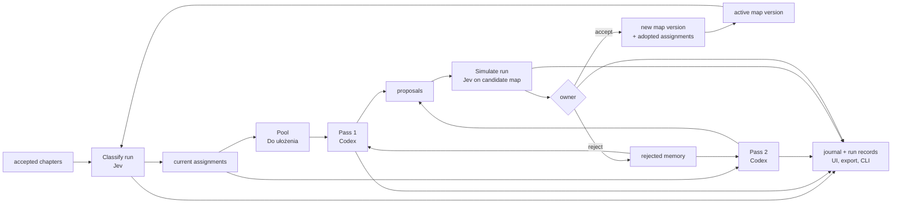

# Topics Lab - Plan

## Goal Capsule

- **Objective:** Add a working admin workspace, Topics (lab), where the owner runs the topic pipeline on live chapters one manual step at a time (classify with Jev, review the unsorted pool with Codex, review the whole map with Codex, simulate every proposal with Jev, accept or reject) and where every step leaves a full, readable record for the owner and for Claude.
- **Authority:** This plan's Product Contract, then its Key Technical Decisions, then the conventions set by Highlights and Chapters (`docs/plans/2026-10-15-001-feat-highlights-and-strands-plan.md`): additive schema, admin CSRF guard, run/proposal/revert shape, sensitive groups opt-in, the "Uses tokens" master switch.
- **Stop conditions:** Stop and ask if the work would change `SCHEMA_VERSION`, add any scheduled or unattended run, expose topics to models over MCP, change chapters, sessions or groups, or send chapter text (not only titles) to any provider.
- **Execution profile:** Backend units test-first against `tests/` with fake Jev and fake Codex clients; UI verified in the demo admin (`scripts/demo_ui.py`); each phase is deployed and checked on production before the next starts.
- **Tail ownership:** Commits land directly on the current `release/*-beta` branch.
- **Design status:** Working layout only. Final design waits until the lab shows which views the owner actually uses.
- **Progress:** Phase A shipped on 2026-10-17. Deviations: settings live in the Topics workspace (Settings step) instead of Sessions › Settings; proposals and pins tables arrive with their phases (C, D, B) instead of in U1; a `?session=&chapter=` link in Sessions opens a chapter from Results.

---

## Product Contract

### Summary

Chapters cut each session into subjects. Topics group chapters across sessions into a picture of what the owner writes about.
Topics are not a quality judgement and never filter anything; they only describe.
The lab reproduces, inside Bridge and on live data, the desktop experiments of 2026-10-16/17 (`~/Desktop/bridge-chapters`): Jev classification, the single "Do ułożenia" pool, Codex pass 1 (pool) and pass 2 (taxonomy, refine only), and per-operation Jev simulation.
Nothing runs on its own. Every run is a button press with a cost estimate in front of it.

### Problem Frame

The owner is deciding four things at once: the processing order, the shape of a future Topics section, how many decisions stay human, and how the whole system behaves over time as sessions keep arriving.
Desktop scripts answered single questions on a frozen export, but cannot show drift, pool growth, or how often a human overrides the machine.
The lab answers these by use: the order of buttons becomes the pipeline, the views the owner opens become the design, and the decisions the owner always confirms the same way become candidates for later automation.

### Concepts

- **Map version:** an immutable list of topics (key, name, description, family, color) plus the pool. Edits and accepted proposals create a new version; exactly one version is active.
- **Pool ("Do ułożenia"):** the one built-in topic for chapters that fit no topic. It cannot be renamed, removed, split or proposed.
- **Unclassified:** a chapter that has no assignment on the active map yet (new or re-cut chapters). Not the same as the pool.
- **Run:** one manual step (classify, pass 1, pass 2, simulate) with its full input, raw output, cost and metrics stored.
- **Proposal:** one operation suggested by pass 1 or pass 2, waiting for simulation and a human decision.
- **Pin:** a human assignment of a chapter to a topic that classification never overwrites.
- **Journal:** an append-only, human-readable log of every step and decision.

### Requirements

**Setup**
- R1. Settings › Topics holds: OpenRouter API key (stored encrypted, write-only in the UI), Jev model (default `typesafe/jev-1.14`), Codex model and effort for passes, include sensitive groups (default off), weak-confidence threshold for the pool view (default off), pool review hint size (default 15). The whole feature sits under the "Uses tokens" master switch.
- R2. A new admin workspace tab, TOPICS, at `/admin/topics`, with the steps as sections: Map, Classify, Pool, Map review, Proposals, Graph, Journal.

**Map**
- R3. The owner can import a map from JSON (the `topics-v6.json` shape) to create the first version.
- R4. The owner can edit a topic's name, description, family and color, add a topic, or retire a topic with zero chapters; every save creates a new version with a note. Old versions stay readable and any version can be re-activated.

**Classify**
- R5. Before running, the Classify step shows how many chapters would be sent (scope: unclassified only, a chosen topic, or all), how many are skipped as sensitive, and the estimated cost in USD.
- R6. A classify run sends each chapter's title, session title and group name to Jev with the active map as choice criteria and stores topic, confidence and full probabilities. Progress is visible and the run can be paused and resumed.
- R7. The result view lists chapters with topic, confidence and second topic (≥20%), filterable by topic, confidence and sensitivity; a row opens the chapter in its session.

**Pool, pass 1**
- R8. The Pool step lists chapters assigned to the pool (and, if the threshold is set, weak assignments shown separately). It shows the hint "15+ chapters: worth a review" but never blocks or triggers.
- R9. Pass 1 sends the pool, the active map and previously rejected proposals to Codex and stores proposals of kind `new_topic`, `fits_existing` or `wait`. Rule in the prompt: a new topic needs at least 3 chapters from at least 2 sessions.

**Map review, pass 2**
- R10. Pass 2 sends every classified chapter outside the pool, grouped by topic, plus rejected proposals, and stores proposals of kind `new_topic`, `split` or `redescribe` (no merge, at most 5). Rule: each new part needs at least 4 chapters from at least 2 sessions.

**Proposals and simulation**
- R11. Each proposal shows Codex's reasoning and intended chapters. "Simulate" builds a candidate map (active map + this one operation) and classifies all eligible chapters with Jev on it as a separate run.
- R12. A simulation shows: agreement with Codex's intent, average confidence in the affected area before and after, chapters pulled in from other topics, chapters that leave, pool size change, and the lists behind each number.
- R13. The owner accepts or rejects a simulated proposal with an optional note. Accept creates and activates a new map version and adopts the simulation's assignments as current. Reject is remembered and sent to later passes.
- R14. A proposal made on an older map version is marked outdated and must be re-simulated or discarded.
- R15. `wait` and `fits_existing` from pass 1 need no simulation; `fits_existing` accept pins those chapters to the named topic.

**Human decisions**
- R16. The owner can pin a chapter to a topic from the result view. Pins survive reclassification; a pin whose topic disappears is shown as orphaned.

**Readability**
- R17. The Journal shows every run, proposal, simulation and decision in time order with actor (owner, Jev, Codex) and links to details.
- R18. Every run can be exported as JSON (input, raw output, metrics). A read-only CLI, `mcp-bridge topics`, prints status, journal, map versions and run details so Claude can follow the lab over SSH without an admin session.

**Graph**
- R19. The Graph step shows the current assignments as the D3 force map from `topic-map-v2.html` (topics, chapters, second-topic links, bridges, sensitive toggle), read-only.

### Acceptance Examples

- AE1. **Covers R5, R6.** With 20 new chapters and 5 in a sensitive group, Classify (unclassified only) shows 15 to send, 5 skipped and an estimate around $0.001; after the run the 15 have assignments and the 5 stay unclassified.
- AE2. **Covers R9.** A pool with 3 chapters about bread from one session yields `wait`, not `new_topic`.
- AE3. **Covers R11, R12.** Simulating the radio split shows agreement 18/19, area confidence 0.84 → 0.93 and two chapters pulled in, with their titles.
- AE4. **Covers R13, R14.** Accepting a split activates version N+1; another proposal made on version N becomes outdated.
- AE5. **Covers R16.** A chapter pinned to `career` stays there after a full reclassification that would put it in `ai_world`.
- AE6. **Covers R18.** `mcp-bridge topics run 12 --json` on the VPS prints the run's prompt, raw response, cost and metrics.

### Scope Boundaries

- Out of scope: schedulers or automatic passes, topics in MCP tools or Contexts, any change to chapters, the final Topics design, chapter text sent to Jev, merging topics, multi-topic assignment per chapter, topics for highlights.
- Proposals never apply themselves; accept is always a click.

### Deferred to Follow-Up Work

- Automation of steps the owner confirms the same way repeatedly (decided from the journal after weeks of use).
- Comparing two map versions side by side on the graph.
- Adding a chapter excerpt to the Jev state when titles prove too thin.
- Topic-based filters in Sessions and Context Builder.

---

## Planning Contract

### Key Technical Decisions

- KTD1. **Separate workspace page.** `web/topics-viewer.html`, `.js`, `.css` served at `/admin/topics`, like Contexts. Keeps `admin-viewer.html` from growing further. The existing LAB tab stays the Graph lab.
- KTD2. **Additive tables, `SCHEMA_VERSION` stays 2.** New store mixin `app/topic_store.py` with `CREATE TABLE IF NOT EXISTS` blocks.
- KTD3. **Map versions are immutable JSON snapshots.** `topic_map_versions(version_id, parent_id, created_at, origin manual|import|proposal, proposal_id, note, topics_json, is_active)`. Assignments reference `version_id`, so old results always read against the map they were made with.
- KTD4. **Chapters are accepted strands.** Assignments key on `strand_id`; when a chapter is deleted, reverted or re-cut, its assignment goes with it (cascade) and new chapters appear as unclassified.
- KTD5. **One run table for every step.** `topic_runs(run_id, kind classify|pool_review|taxonomy_review|simulate, version_id, proposal_id, status queued|running|paused|completed|failed, settings_json, input_json, output_json, metrics_json, cost_usd, error, created_at, started_at, finished_at)`. Full prompt and raw response are stored, never trimmed; this is the readable trace.
- KTD6. **Assignments belong to runs.** `topic_assignments(run_id, strand_id, topic_key, confidence, probabilities_json)`. "Current" is the latest completed classify run per chapter on the active version, plus adopted simulation runs. A simulation never changes current assignments until accepted.
- KTD7. **Proposals.** `topic_proposals(proposal_id, run_id, version_id, op, payload_json, status pending|simulated|accepted|rejected|outdated, simulation_run_id, decision_note, decided_at)`.
- KTD8. **Pins and journal.** `topic_pins(strand_id, topic_key, created_at)`; `topic_journal(event_id, created_at, actor, action, run_id, proposal_id, version_id, message)`.
- KTD9. **Jev client is plain HTTPS.** `app/jev_client.py` calls `POST https://openrouter.ai/api/alpha/decisions` with `{model, state, questions.topic {type choice, instructions, criteria}}`, retries 429/5xx with backoff, parallelism 6, reads `usage.cost`. The pool topic is always the last criterion.
- KTD10. **Codex passes reuse `CodexAppServerClient.extract_structured`.** Prompts and schemas move from the desktop runner (`request-pass1.json`, `request-pass2.json`) into `app/topic_prompts.py`, with a "previously rejected" section added.
- KTD11. **Runs follow `StrandRuntime`.** In-process background task, one topics run at a time, `recover()` at startup marks interrupted runs paused (classify) or failed (Codex).
- KTD12. **Metrics are computed on the server** (`app/topic_metrics.py`) from assignments, so the UI, the export and the CLI show the same numbers.
- KTD13. **Secret storage.** The OpenRouter key uses the admin `_encrypt_secret` path like `ai_rename.api_key`; it never appears in runs, exports, journal or CLI output.
- KTD14. **CLI reads the database read-only.** `mcp-bridge topics status|journal|versions|run <id>|export` opens SQLite in read-only mode and prints text or `--json`.

### High-Level Technical Design

### Sequencing (phases, each deployed and checked before the next)

1. **Phase A, observe:** U1, U2, U3, U4, U9 (store, Jev, settings, classify, CLI). Checkpoint: classify all live chapters on the imported v6 map and compare with the desktop result.
2. **Phase B, see:** U5 (results, pins, graph). Checkpoint: the graph matches `topic-map-v2.html`.
3. **Phase C, pool:** U6 (pass 1 + proposals without simulation). Checkpoint: one pass 1 on the live pool, read through the journal.
4. **Phase D, decide:** U7 (simulation, accept, reject, versions). Checkpoint: simulate and accept one split.
5. **Phase E, refine:** U8 (pass 2). Checkpoint: one pass 2, every proposal simulated.
6. **Phase F:** U10 docs and changelog.

### Assumptions

- About 500 chapters today; a full classify costs about $0.04 and takes about a minute.
- Titles plus session title plus group are enough context for Jev (agreement 97% between runs in the desktop test).
- Pass 2 prompt for ~500 chapters is about 65k characters, within `MAX_STRUCTURED_INPUT_CHARS`.

---

## Implementation Units

### U1. Topic store

- **Goal:** Persist map versions, runs, assignments, proposals, pins and journal.
- **Requirements:** R3, R4, R14, R16, R17
- **Files:** `app/topic_store.py` (new), `app/storage.py` (mixin), `tests/test_topic_store.py` (new)
- **Approach:** Tables per KTD3–KTD8. Methods: import map, save new version, activate version, list versions; create/update/finish run; write assignments in one transaction; current assignments (with pins applied); list unclassified chapters; proposals CRUD with outdated marking on version change; pins; journal append and list.
- **Test scenarios:** import validates keys and keeps the pool last; edit creates a new version and keeps the old; activate marks other-version proposals outdated; deleting a strand removes its assignment and pin; current assignments prefer pins and ignore simulations until adopted; retire refuses a topic that still has chapters.

### U2. Jev client and settings

- **Goal:** Classify one chapter through OpenRouter and keep the key safe.
- **Requirements:** R1, KTD9, KTD13
- **Files:** `app/jev_client.py` (new), `app/admin_topics.py` (new), `app/main.py`, `tests/test_jev_client.py` (new)
- **Approach:** Client with injected transport for tests. Settings endpoints for key (write-only, shows "set"/"not set"), model, Codex model and effort, sensitive switch, threshold, hint size; all behind the token master switch.
- **Test scenarios:** body shape matches the decisions API; 429 then 200 succeeds; 400 fails with the provider message; key never appears in a settings GET.

### U3. Classify runtime

- **Goal:** Run, pause and resume classification over a chosen scope.
- **Requirements:** R5, R6, KTD11
- **Files:** `app/topic_runtime.py` (new), `app/admin_topics.py`, `tests/test_topic_runtime.py` (new)
- **Approach:** Estimate endpoint (counts, skipped sensitive, USD at the last observed cost per chapter, default $0.00008). Run stores input state per chapter, writes assignments in batches of 25, records cost, supports pause and resume, journal entries at start, pause, finish.
- **Test scenarios:** covers AE1; pause keeps written assignments and resume sends only the rest; three provider errors in a row pause the run; restart recovers a running classify as paused.

### U4. Topics workspace shell, Map and Classify views

- **Goal:** The TOPICS tab with working Map and Classify sections.
- **Requirements:** R2, R3, R4, R5, R6
- **Files:** `web/topics-viewer.html`, `web/topics-viewer.js`, `web/topics-viewer.css` (new), `web/admin-viewer.html` (nav tab), `app/admin.py` (page), `app/main.py` (route)
- **Approach:** Left column of steps with counts (topics, unclassified, pool, pending proposals); Map section with topic table, edit dialog, import, version list; Classify section with scope picker, estimate, Start/Pause/Resume, progress bar. Reuses admin tokens, buttons, spinner and confirmation dialog.
- **Verification:** demo admin: import a map, classify demo chapters, see counts update.

### U5. Results, pins and graph

- **Goal:** Read and correct classification and see it as a graph.
- **Requirements:** R7, R16, R19
- **Files:** `web/topics-viewer.*`, `app/admin_topics.py`
- **Approach:** Result table with filters and "open in session" link; pin/unpin from a row; Graph section embeds D3 (pinned CDN version) with the template from `topic-map-v2.html`, fed from the current-assignments endpoint.
- **Test scenarios:** covers AE5; pinned rows show a pin mark; orphaned pin is listed.

### U6. Pass 1 and proposals list

- **Goal:** Codex reviews the pool and leaves proposals.
- **Requirements:** R8, R9, R15
- **Files:** `app/topic_prompts.py` (new), `app/topic_runtime.py`, `app/admin_topics.py`, `web/topics-viewer.*`, `tests/test_topic_passes.py` (new)
- **Approach:** Prompt and schema from the desktop pass 1 plus rejected memory; strict validation (every pool chapter in exactly one decision, known topic keys, new keys unique). Proposals list with reasoning and chapters; `wait` is informational; `fits_existing` accept pins.
- **Test scenarios:** covers AE2 with a fake Codex; invalid result (missing chapter id) fails the run and stores nothing.

### U7. Simulation and decisions

- **Goal:** Test one proposal at a time and accept or reject it.
- **Requirements:** R11, R12, R13, R14
- **Files:** `app/topic_metrics.py` (new), `app/topic_runtime.py`, `app/admin_topics.py`, `web/topics-viewer.*`, `tests/test_topic_metrics.py` (new)
- **Approach:** Candidate map built from active version + operation; simulate run is a classify run with `kind=simulate` and `proposal_id`; metrics per KTD12; accept creates version (origin proposal), activates it, adopts the simulation's assignments, marks other proposals outdated; reject stores the note.
- **Test scenarios:** covers AE3 on fixture data (numbers computed exactly); covers AE4; a split leaving any chapter of the old topic unassigned is refused by validation.

### U8. Pass 2

- **Goal:** Codex reviews the whole map and proposes refinements.
- **Requirements:** R10
- **Files:** `app/topic_prompts.py`, `app/topic_runtime.py`, `web/topics-viewer.*`, `tests/test_topic_passes.py`
- **Approach:** Prompt and schema from the desktop pass 2 plus rejected memory; split parts must cover all chapters of the target topic; `merge` is not in the schema.
- **Test scenarios:** split with uncovered chapter is rejected; more than 5 operations rejected; `no_change` stores no proposal and journals "map unchanged".

### U9. Journal, export and CLI

- **Goal:** Make every step readable by the owner and by Claude.
- **Requirements:** R17, R18, KTD14
- **Files:** `app/admin_topics.py`, `web/topics-viewer.*`, `bridge_cli/topics.py` (new), `bridge_cli/__main__.py`, `tests/test_topics_cli.py` (new)
- **Approach:** Journal section with filters by actor and kind; "Export JSON" per run; CLI `mcp-bridge topics status|journal [--since]|versions|run <id>|export --out` reading SQLite read-only, `--json` everywhere. Lands in phase A so every later phase is observable from day one.
- **Test scenarios:** covers AE6; CLI output contains no OpenRouter key; CLI fails cleanly when the tables do not exist yet.

### U10. Docs and changelog

- **Files:** `CHANGELOG.md`, `docs/limitations.md`, `docs/operations.md`
- **Approach:** Describe the lab, costs, the sensitive rule, what is sent to OpenRouter (titles only), and the CLI.

---

## Verification Contract

| Gate | Command or check | Applies to |
|---|---|---|
| Unit and API tests | `uv run pytest` | U1–U3, U6–U9 |
| Demo admin walkthrough | `uv run python scripts/demo_ui.py`, then `/admin/topics` | U4–U8 |
| Live checkpoint per phase | Owner runs the phase's step on production; Claude reads it with `mcp-bridge topics journal` over SSH | each phase |
| Schema compatibility | `SCHEMA_VERSION` unchanged; existing database opens | U1 |

## Definition of Done

- R1–R19 met; AE1–AE6 covered by tests or the demo walkthrough.
- No run starts without a click; no scheduler entry exists for topics.
- Every run's input and raw output is readable in the UI, the export and the CLI.
- The OpenRouter key never leaves encrypted settings.
